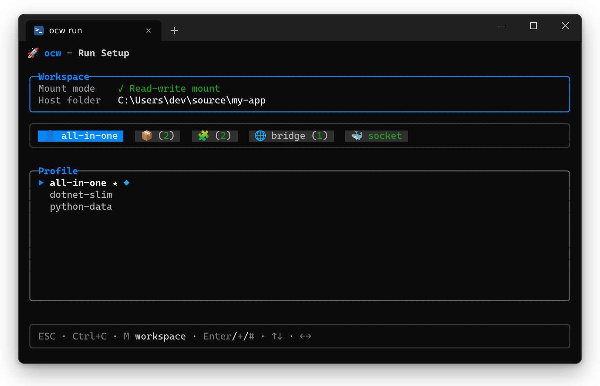
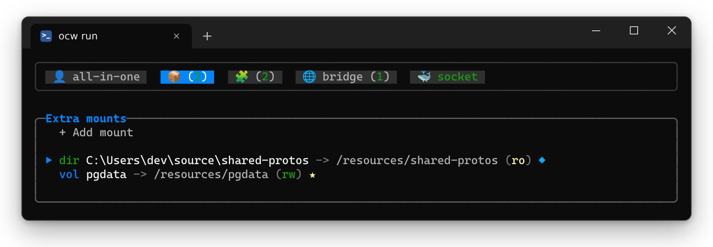
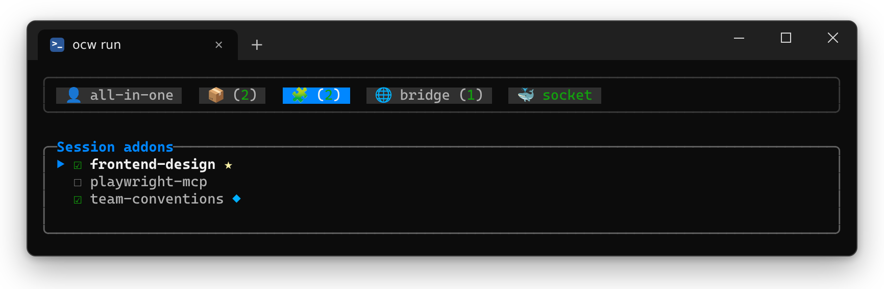
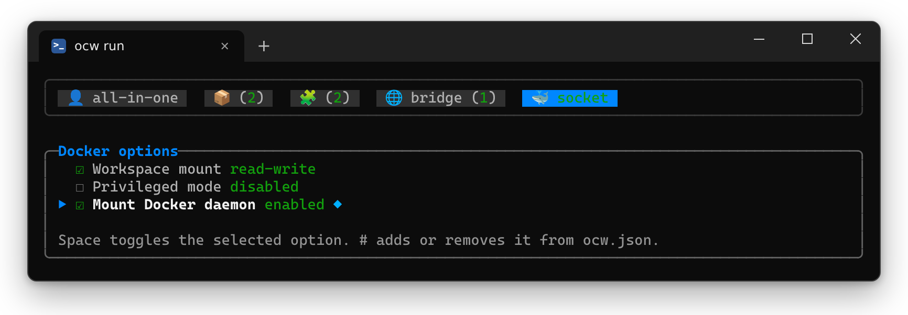

# OpencodeWrap (`ocw`)

Run [OpenCode](https://opencode.ai) V2 in Docker on Windows. The OpenCode server and every command it runs live in a container, while the TUI runs natively in your terminal. Your project folder is mounted in, and sessions, auth and settings persist between runs.



## Requirements

- Windows x64 with an AVX2-capable CPU
- Docker Desktop running Linux containers
- Node.js / npm, for installing and updating

## Install

```powershell
npm i -g @farsight-cda/ocw
```

## Usage

```powershell
cd C:\path\to\your\project
ocw run
```

Pick a setup and press **Enter**. The current folder is mounted at `/workspace/<folder-name>`. Each run uses the latest stable OpenCode release and pins it for that session.

Entries marked ★ are your personal defaults. Entries marked ◆ come from the project's `ocw.json`, which you can commit to share the setup.

### Extra mounts

Add more host folders or Docker named volumes, read-only or read-write. They're mounted at `/resources/<name>` by default.



### Session addons

Turn [addons](#addons) on or off for this run.



### Docker networks

Use `bridge` (the default) or `host`. `host` requires host networking to be enabled in Docker Desktop. In bridge mode you can also attach existing networks, such as your compose project's network.


### Docker options

Disable the workspace mount, run the container privileged, or mount the Docker daemon. Mounting the daemon gives the agent access to your host's Docker.



## Profiles

A profile defines the container's toolchain. The built-in **`all-in-one`** profile covers frontend, .NET, Go, Rust, Postgres/data, Solidity and Ansible.

```powershell
ocw profile add <name>       # create %USERPROFILE%\.opencode-wrap\profiles\<name>
ocw profile add all-in-one   # editable copy that overrides the built-in
ocw profile build <name>     # rebuild the image without cache
ocw profile <list|open|delete>
```

```text
<name>\
├── Dockerfile      # your toolchain; must include Node.js + npm
├── bin\            # added to PATH
├── opencode\       # OpenCode config dir: opencode.json, AGENTS.md, skills, ...
├── .env            # optional, container environment variables
└── entrypoint.sh   # optional custom startup; must exec opencode2 "$@"
```

## Addons

Addons are folders that get layered on top of the profile for a run. Use them for skills, agent instructions, MCP config, or optional tools you don't want baked into every profile. Built-in addons:

| Addon | Adds |
| --- | --- |
| `frontend-design` | The frontend design skill |
| `claude-code` | The `claude` CLI, formerly included in `all-in-one`. Enable this addon to keep using it; the sign-in directory is still `/ocw/state/claude-code`. |
| `antigravity` | Google's `agy` CLI and the pinned `opencode-antigravity-acp@0.2.0` plugin. Run `agy` in the terminal pane or select an **Antigravity (ACP)** model in OpenCode. |
| `antigravity-code-mode` | Select alongside `antigravity` to enable the plugin's Code Mode bridge by default for Antigravity sessions. |

```powershell
ocw addon add <name>   # create %USERPROFILE%\.opencode-wrap\addons\<name>
ocw addon <list|open|delete>
```

Addons use the same layout as a profile, minus the `Dockerfile`. `opencode/opencode.json`, `opencode/AGENTS.md` and `.env` are merged. If any other file collides with the profile or another addon, the launch is blocked.

### Installing tools with an addon

An optional `build/install.sh` runs in Linux during a Docker image build, not on Windows or at session startup. Save it with LF line endings. OCW runs it with Bash from the addon build directory, so it can use sibling files by relative path:

```text
my-addon/
├── build/
│   ├── install.sh
│   └── tool-config.json
├── .env
└── opencode/
```

Only `build/` is sent to Docker as addon build input. Its files aren't included in the runtime overlay; the script must install tools and files you want to keep somewhere outside the build directory. Keep credentials out of `build/`. Symlinks and junctions aren't supported there.

The image order is **base profile → OpenCode runtime → selected build addons**. 
Addon layers are built in alphabetical order and cached by parent image and `build/` contents. 
Config-only addons don't create layers. The run menu marks addons with install scripts as **(image build)**.


## Update

```powershell
ocw update           # install the latest release
ocw update --check   # check only
```

## License

[MIT](LICENSE.txt)
